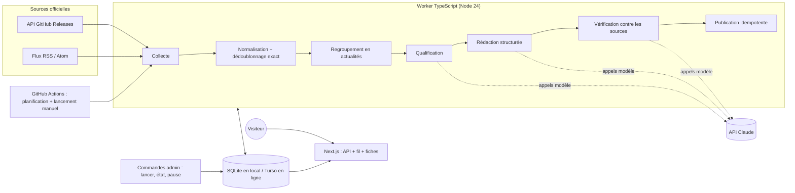
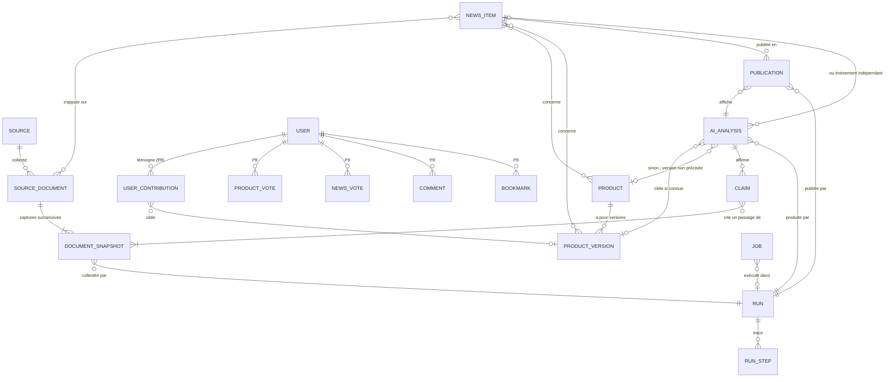

# Comprendre le projet CURATION AI

> Document de compréhension et de présentation, mis à jour au fil des jalons.
> **Dernière mise à jour : 2026-10-30, P2 en cours.** **Construit et vérifié : la collecte fiable** (section 4 bis) **et le catalogue produits, versions, actualités sur 5 sources officielles** (section 4 ter), avec une **maquette** du fil à valider. Le reste décrit la conception validée ; chaque partie passe de « prévu » à « réalisé » avec ses preuves (dossier [`linkedin/`](linkedin/)).

## Sommaire

1. Le projet en une minute
2. Le problème et le public
3. Ce que verra un visiteur
4. La chaîne de traitement
5. Site, workflow, agent : qui décide quoi
6. Les données
7. Les choix techniques et leurs raisons
8. Ce que ça coûte
9. Les garde-fous éditoriaux
10. Qui fait quoi
11. Avancement
12. Glossaire

---

## 1. Le projet en une minute

CURATION AI est un site en français qui repère les nouveautés de l'IA utiles aux développeurs (assistants et agents de code, skills, serveurs MCP, modèles, fonctionnalités), les explique à partir des sources officielles et, plus tard, laisse la communauté confirmer, nuancer ou réfuter ces analyses avec ses propres tests.

Le fil s'alimente sans rédaction manuelle : une tâche planifiée collecte les annonces officielles, un modèle d'IA rédige une analyse dont chaque affirmation pointe vers un passage source, des contrôles décident de la publier ou non, et chaque publication garde la trace de l'exécution qui l'a produite.

## 2. Le problème et le public

**Le problème.** Les nouveautés sortent plus vite qu'on ne peut les suivre. Une annonce officielle dit ce qui change, rarement à qui cela sert ni ce que cela vaut en pratique ; les retours de terrain sont éparpillés et rarement rattachés à une version précise.

**Le public.**
- En priorité : les développeurs, étudiants et créateurs de projets qui utilisent l'IA pour construire des choses concrètes.
- En second : les profils data / IA qui suivent les modèles (benchmarks, licences, coûts).

**Leur besoin :** découvrir vite ce qui sort, comprendre à quoi ça sert, décider si ça mérite d'être testé.

**La ligne éditoriale.** Le cœur du site, ce sont les assistants et agents de code et leur écosystème ; s'y ajoute une sélection des grandes nouveautés des modèles et des applications IA. Chaque publication répond à trois questions : *que permet concrètement la nouveauté ? pour qui ? quelles sont ses limites connues ?* Le site publie peu, mais en profondeur.

## 3. Ce que verra un visiteur _(prévu ; maquette en P2)_

| Étape | Ce que le visiteur fait | Jalon |
|---|---|---|
| Découverte | fait défiler un fil de cartes : titre, résumé, intérêt concret, catégories, date de l'annonce, date de publication, sources, badge « Analyse IA à partir des sources — non testé par la plateforme » | P4 |
| Investigation | ouvre une fiche : ce qui change, versions, cas d'usage, coût, licence (« Non renseigné » si inconnu), benchmarks attribués à leur auteur, documentation, dépôt, questions à tester, historique des versions | P4 |
| Contribution | confirme, nuance ou réfute l'analyse en précisant version, matériel, tâche, mesures et conditions ; les avis humains sont affichés à part | P8 |
| Rétention | reçoit une newsletter, sur inscription volontaire | P9 |

Au lancement, il n'y a pas de communauté : le site doit être utile avec les seules analyses documentaires, sans jamais simuler de membres, de votes ou d'avis.

**La maquette (P2).** Avant de construire le vrai site (P4), une maquette statique montre le fil et la page de détail, sur téléphone et ordinateur, avec de vraies actualités collectées ([`maquette/index.html`](../maquette/index.html), générée par `npm run maquette`). Elle est construite autour de la mascotte fournie par le porteur du projet ([`assets/brand/`](../assets/brand/)) : le « visage » sombre de la mascotte devient la tuile de chaque carte, où le numéro de version s'affiche en lettres claires comme ses yeux ; la mascotte elle-même accueille le visiteur et illustre les états de chargement, de liste vide, d'erreur et de fin de fil. Ce qu'elle montre honnêtement : aucune analyse n'existe encore, donc chaque champ d'analyse affiche « Non renseigné » et chaque carte porte « Collecté, pas encore analysé » ; un bandeau rappelle que rien n'est publié. Les titres et extraits restent en langue originale, cités et liés à leur source.

## 4. La chaîne de traitement _(prévu)_

| Étape | Ce qu'elle fait | Qui la réalise | Jalon |
|---|---|---|---|
| Collecte | interroge des sources officielles (API, flux) et enregistre les documents bruts avec leur provenance | code déterministe | **P1 — réalisé** |
| Normalisation, dédoublonnage | uniformise URL et dates, calcule une empreinte (hash) du contenu, écarte les doublons exacts | code déterministe | P1–P2 |
| Regroupement | rassemble les documents de sources différentes qui parlent de la même annonce, sans confondre republication récente et événement récent | code, puis modèle si utile | P6 (après la V1) |
| Qualification | pertinence, catégorie, nouveauté, disponibilité réelle, annonce ou rumeur | appel au modèle | P3 |
| Rédaction | produit une analyse en français, au format imposé, chaque affirmation accompagnée d'une citation de la source | appel au modèle | P3 |
| Vérification | contrôle que chaque citation se retrouve **mot pour mot** dans le document stocké, et repère les contradictions (jamais un simple second avis du même modèle) | code déterministe | P3 |
| Publication | publie une seule fois, même en cas de relance ; sinon « à vérifier » ou « rejeté » avec motif | code déterministe | P5 |

**Le principe des jobs.** Chaque travail à faire est une ligne dans une table de jobs. Un worker « réserve » un job pour une durée limitée (un *bail*) par une seule instruction SQL (`UPDATE … RETURNING`), avec attente et nouvelle tentative si la base est momentanément verrouillée. Deux workers lancés en même temps ne prennent jamais le même job : **vérifié en P1** par un test où deux processus se partagent 300 jobs sans en réserver un seul deux fois. Si un worker plante, le bail expire et le job peut être repris, un nombre limité de fois. Chaque publication portera une clé d'idempotence : un second essai après un délai dépassé sera reconnu et ne créera pas de doublon.

## 4 bis. Ce qui fonctionne déjà : la collecte _(P1, réalisé le 2026-10-30)_

**Ce que fait le programme.** La commande `npm run collect` interroge l'API officielle de GitHub pour récupérer les 5 dernières versions publiées de Claude Code (son « changelog »). Chaque version devient un document enregistré dans une base SQLite, avec sa provenance : l'identifiant donné par GitHub, l'adresse d'origine et une adresse normalisée, la date de publication annoncée par la source, la date de collecte, le texte des notes de version et son empreinte (hash). Aucune IA n'intervient : c'est du code déterministe.

**Comment l'observer.**

| Commande | Ce qu'on voit |
|---|---|
| `npm run collect` | « 5 nouveau(x) » la première fois, « 0 nouveau(x), 5 inchangé(s) » ensuite |
| `npm run status` | pause, nombre de documents et de captures, état de la source, dernières exécutions |
| `npm run export` | le fichier `exports/source-documents.json`, lisible, avec chaque document et ses captures |
| `npm run pause` puis `npm run collect` | « Collecte en pause » : aucune requête n'est envoyée |

**Les idées clés, en clair.**
- **Idempotence** : relancer la collecte ne crée jamais de doublon. Un document est reconnu par son identifiant à la source ; s'il n'a pas changé, rien n'est ajouté.
- **Capture** : si les notes d'une version sont modifiées après coup, le programme garde l'ancienne version et ajoute une nouvelle capture. L'empreinte (hash) sert à savoir si le texte a changé.
- **Transaction** : un groupe d'écritures qui réussit en entier ou pas du tout. Ici, enregistrer les documents, clore le job et noter le résultat se font d'un seul bloc : un arrêt brutal ne laisse jamais une base à moitié écrite.
- **Bail** : un job réservé appartient au worker pendant 5 minutes. Si le worker disparaît, le bail expire, l'exécution est marquée « interrompue » et le job est repris.
- **Pause** : un interrupteur en base ; tant qu'il est actif, aucun job n'est réservé.
- **Collecte protégée** : le programme ne contacte que des adresses autorisées (ici `api.github.com`), vérifie l'adresse IP réelle avant de se connecter, exige un certificat valide, refuse les redirections, et limite la durée et la taille des réponses. Cela empêche de détourner la collecte vers des machines internes.

**Comment c'est vérifié.**
- **90 tests automatiques** sur des données figées (une vraie réponse de l'API enregistrée), sans réseau : doublons, contenu modifié, huit pannes de source différentes (les données restent intactes), pause, deux collecteurs lancés en même temps, processus tué pendant la récupération puis pendant l'enregistrement, verrou de la base tenu trop longtemps par un autre programme.
- **Une relecture adversariale** du code par trois agents, chaque remarque contre-vérifiée par un quatrième : 18 défauts confirmés, tous corrigés et couverts par un test. Le plus subtil : après une attente de verrou trop longue, le pilote de base de données gardait une connexion inutilisable ; le correctif rouvre les connexions avant de réessayer, et le test qui le prouve échoue si on retire le correctif.
- **Un essai réel** le 2026-10-30 à 01:26 UTC : 5 versions réelles collectées (v2.1.309 à v2.1.314, cette dernière publiée la nuit même), seconde collecte sans doublon, pause respectée. Journal et vérifications SQL dans [`linkedin/02-collecte/preuves/`](linkedin/02-collecte/preuves/).

**Limites assumées.** Une seule source pour l'instant (c'est le rôle de P2 d'en ajouter). La politique de durée de conservation des captures sera fixée avant la mise en ligne. L'arrêt brutal et la panne de source n'ont été provoqués qu'en test, pas sur la vraie source.

## 4 ter. Produits, versions et actualités _(P2, en cours de validation)_

**Ce que fait le programme.** La collecte couvre maintenant 5 sources officielles : les pages de versions (« releases ») GitHub de Claude Code, Codex CLI et Gemini CLI, et les flux RSS d'OpenAI News et du GitHub Changelog. Chaque document collecté est ensuite rangé, sans IA, dans un petit catalogue :

| Notion | Ce que c'est | Comment on le reconnaît |
|---|---|---|
| **Produit** | un outil suivi (ex. Codex CLI) | une clé fixe déclarée dans la configuration (`openai/codex`), jamais devinée à partir d'un nom |
| **Version** | une version d'un produit (ex. 0.166.0) | le produit + le numéro lu dans l'étiquette de la release (`rust-v0.166.0` → `0.166.0`) |
| **Actualité** | une ligne du fil | une version stable publiée, ou une annonce d'un flux |

**Les règles, en clair.**
- **Préversions** : Codex et Gemini publient surtout des versions d'essai (17 et 18 sur 20). Elles sont gardées dans l'historique des versions, mais ne deviennent une actualité que si elles passent en version stable : sinon le fil serait noyé.
- **Pas de doublon** : une même annonce collectée deux fois, republiée avec une nouvelle date, ou une release supprimée puis recréée sur GitHub ne donne jamais deux actualités. La base elle-même l'interdit (règles d'unicité), pas seulement le programme.
- **Annonces des flux** : elles ne disent pas de quel produit elles parlent ; elles restent « sans produit » jusqu'à la qualification par l'IA (P3).
- **Liens vérifiés** : une entrée de flux n'est acceptée que si son lien pointe en https vers le site officiel de la source ; sinon elle est refusée et le refus est compté dans la trace.
- **Trou possible** : certains flux ne gardent que leurs 10 dernières entrées. Si toutes les entrées reçues sont nouvelles, le programme le signale : des annonces ont pu passer entre deux collectes.

**Comment c'est vérifié.**
- **150 tests automatiques** (108 avant ce jalon), sur de vraies réponses enregistrées : doublons, préversions, release recréée, tag corrigé, flux en panne de six façons différentes (les données restent identiques), liens refusés, contenus piégés.
- **Deux relectures par des agents** chargés de chercher des failles. La première : 27 constats, dont 25 confirmés par un second agent, plus 7 manques relevés par un critique de complétude. La seconde, sur les corrections et la maquette : 17 constats démontrés. Tous ont été corrigés et couverts par un test, ou documentés quand il s'agissait d'une limite assumée. Exemples : un texte comme « &lt;img&gt; » dans un flux devenait une vraie balise après un double décodage ; une démonstration hors ligne fabriquait de fausses versions de Codex à partir des données de Claude Code ; une seconde collecte lancée juste après une panne sautait la source en panne sans le dire. Les nouveaux tests ont été vérifiés en échec sur l'ancien code.
- Le détail des règles et des options écartées est dans [l'ADR 0003](../docs/decisions/0003-identite-produits-versions-actualites.md).

**L'essai réel (2026-10-30, 02:25 UTC).** Sur la base de P1, mise à jour : 1re collecte, les 5 sources réussissent, 65 nouveaux documents, et les 5 versions de Claude Code collectées en P1 sont rattachées au catalogue ; 44 actualités (14 versions, 30 annonces), 3 produits, 40 versions dont 26 préversions. 2e collecte : 0 nouveau document, 0 nouvelle actualité. Les vérifications par requête SQL confirment l'absence de doublon et que chaque release est rattachée à exactement une version. Journal, requêtes, extrait de l'export et captures de la maquette : [`linkedin/03-catalogue/preuves/brut/`](linkedin/03-catalogue/preuves/brut/).

**Ce que l'essai réel a appris.** Un premier essai sur une copie de la base a montré que la réponse de GitHub pour Codex CLI dépassait la limite de taille (environ 350 fichiers joints par version, 11 Mo pour 20 versions) : les données de test, réduites, ne le montraient pas. Codex a désormais sa propre limite (12 Mio, pour 10 versions) ; sa réponse réelle pesait 5,3 Mio lors de l'essai.

**Limites assumées.** Les annonces des flux ne sont pas encore rattachées à un produit (P3). Une entrée de flux dont l'adresse change réapparaît comme nouvelle. La fréquence de collecte de chaque source ne sera appliquée qu'avec la planification (P5) ; d'ici là, le programme signale un « trou possible ».

## 5. Site, workflow, agent : qui décide quoi

On parle souvent d'« agents » pour tout. Pour construire un système fiable et peu coûteux, il faut se demander à chaque étape : **qui décide de l'étape suivante ?**

| Notion | Image | Qui décide de la suite ? | Dans ce projet |
|---|---|---|---|
| **Site** | le kiosque : il montre ce qui est en base | le visiteur | le fil et les fiches |
| **Workflow** | une chaîne de fabrication avec une procédure écrite | le code, toujours dans le même ordre | collecte → normalisation → rédaction → vérification → publication |
| **Agent** | un journaliste à qui l'on donne un objectif et des outils | le modèle, dans des limites fixées | éventuellement après la V1 (P6), si cela améliore mesurablement les fiches |

**Les notions utiles :**
- **Appel de modèle** : une requête (instructions + données) produit une réponse. Le modèle ne fait rien d'autre.
- **Sortie structurée** : on impose une réponse au format JSON, contrôlée par un schéma ; si elle est invalide, elle est rejetée ou redemandée.
- **Outil** : une fonction de notre code que le modèle peut *demander* (par exemple « lire cette page autorisée ») ; c'est notre code qui l'exécute et la contrôle.
- **Boucle d'agent** : le modèle choisit l'outil suivant, observe le résultat, recommence, jusqu'à une **condition d'arrêt**. Une boucle sérieuse a un objectif, des entrées, une liste d'outils autorisés, un nombre maximal d'itérations, un budget, une sortie structurée et une gestion des erreurs.
- **Mémoire** : ici, c'est la base de données (documents, analyses, traces), pas « la tête » du modèle.
- **Traces** : on enregistre les actions et leurs résultats (étapes, documents utilisés, tokens, coût), jamais le raisonnement interne du modèle.

**Exemples concrets :**
- La collecte de P1 est du **code déterministe** : aucune décision, aucune IA.
- La rédaction de P3 est **un appel de modèle** avec sortie structurée, à une étape fixe d'un **workflow**.
- Un **agent** n'apparaîtra que si un choix dynamique apporte une valeur démontrée — par exemple décider d'aller lire la documentation citée par une note de version, avec un outil limité aux domaines autorisés.

À ne pas confondre : les *skills* de Claude Code servent à développer le projet ; ils ne sont pas les agents exécutés par le site.

## 6. Les données _(prévu)_

**Six règles qui garantissent la fiabilité :**
1. **Provenance.** Chaque document collecté garde sa source, son identifiant externe, son URL d'origine et normalisée, sa date d'annonce (vide si inconnue) et sa date de collecte.
2. **Captures successives.** Un document est une identité ; chaque version de son contenu est une capture distincte, identifiée par son empreinte (hash). Même empreinte : rien ne change. Contenu modifié : nouvelle capture. L'empreinte identifie un contenu, elle ne le remplace pas.
3. **Affirmations sourcées.** Chaque affirmation (CLAIM) d'une analyse IA cite un passage qui doit se retrouver mot pour mot dans la capture stockée. Ce contrôle, fait par du code, est indépendant du modèle.
4. **Inconnu n'est pas zéro.** Une valeur inconnue est vide (`null`) en base et s'affiche « Non renseigné » ; « inconnu », « non applicable », « gratuit » et « 0 » sont quatre choses différentes.
5. **Rien d'inventé.** Les votes sur un produit et sur une actualité sont séparés et commencent à zéro ; les avis externes (X, Reddit, GitHub) restent des contenus attribués, pas des avis de membres.
6. **Traçabilité.** Depuis une publication, on remonte à l'analyse affichée, puis à l'exécution (RUN) qui l'a produite et à ses étapes.

La fiche produit n'est pas une table de plus : c'est une vue calculée à partir des produits, versions, actualités, analyses et contributions.

## 7. Les choix techniques et leurs raisons

| Élément | Choix | Pourquoi | Écarté |
|---|---|---|---|
| Langage | TypeScript partout | un seul langage ; les mêmes schémas servent au site et au worker ; SDK officiel Anthropic et lecture de flux disponibles | un worker Python : aucun bénéfice concret identifié |
| Site et API | Next.js 16, React 19 | cadre stable ; les « Route Handlers » suffisent pour une petite API JSON | — |
| Worker | scripts TypeScript exécutés directement par Node 24 | Node retire les types lui-même (fonction stable depuis la v24.12) : pas d'étape de compilation | outils de compilation supplémentaires |
| Base de données | SQLite (un fichier) en local, Turso en ligne, même code via `@libsql/client` | aucune installation ni compte pour démarrer ; fichier facile à inspecter ; un seul dialecte SQL du local à la production | PostgreSQL : rien d'installé localement, et sa version embarquée (PGlite) n'accepte qu'une connexion, ce qui empêche de tester deux collecteurs simultanés |
| Accès aux données | Drizzle ORM 0.45.4 | schéma typé et migrations en fichiers SQL lisibles | la v1 de Drizzle, encore en version candidate |
| Planification | GitHub Actions | gratuit, exécution jusqu'à 6 h, bouton de lancement manuel | Vercel Cron : une seule exécution par jour sur l'offre gratuite |
| Tests | Vitest 5 | compatible Node 24, rapide | — |
| IA | SDK officiel `@anthropic-ai/sdk`, sorties structurées validées par schéma | la clé API ne quitte jamais le serveur | — |
| Sécurité de collecte | liste blanche d'hôtes, validation des adresses IP résolues (connexion uniquement à l'adresse validée), pas de suivi de redirection, délai et taille maximum | réduit le risque de détourner la collecte vers des ressources internes (attaque « SSRF », recommandations OWASP) | — |

**Comment ces choix ont été vérifiés.** Les versions ont été lues sur le registre npm le 2026-10-30. Les limites et tarifs proviennent de deux recherches menées par des agents de Claude Code, presque entièrement dans les documentations officielles (plus quelques mesures locales), chaque information étant ensuite contre-vérifiée par un second agent chargé de la réfuter : 279 informations, dont 270 confirmées, 7 corrigées et 2 jugées invérifiables — des tarifs Cloudflare relevés sur un site tiers (non utilisés) et la sûreté de la réservation de jobs sur SQLite (hypothèse de conception, à tester en P1). Détail dans [`linkedin/01-cadrage/preuves/`](linkedin/01-cadrage/preuves/).

## 8. Ce que ça coûte _(relevé le 2026-10-30 sur les sources officielles)_

**Dépense engagée à ce jour : 0 €.** Toute dépense est soumise à la validation du porteur du projet.

**Domaine (à l'achat, au déploiement).** Recommandation : un `.fr` chez OVHcloud, 5,99 € TTC la première année puis 9,35 € TTC par an — le renouvellement le moins cher relevé, éligible pour un résident en France, coordonnées masquées gratuitement pour un particulier. Le renouvellement automatique est indispensable : récupérer un domaine expiré coûte environ 50 € HT.

**Hébergement : 0 € par mois visé, dans les quotas gratuits.**

| Composant | Service | Conditions principales |
|---|---|---|
| Site | Vercel Hobby | usage personnel et non commercial ; domaine personnalisé accepté |
| Worker planifié | GitHub Actions | gratuit en dépôt public ; 12 $ de calcul inclus par mois en dépôt privé, blocage (et non facturation) au-delà sans carte |
| Base | Turso Free | 5 Go ; archivage possible après 10 jours d'inactivité (une collecte quotidienne l'évite) |

Solutions payantes de repli, chacune à valider : Turso Developer (4,99 $/mois) ; Vercel Pro (20 $/mois HT, nécessaire pour rester sur Vercel si le site devenait commercial, l'offre Hobby étant réservée à un usage non commercial) ; petit serveur Hetzner (à partir de 6,49 € HT/mois en CPX, disponibilité à vérifier — les offres CX/CAX à partir de 5,99 € HT étaient indiquées « non disponibles » le 2026-10-30).

**IA : couverte par les crédits de l'abonnement (estimation).** D'après la documentation officielle, l'abonnement Claude Max 5x inclut 100 $ de crédits API par mois, à réclamer sur claude.ai et à lier à une organisation de la Claude Console. Ils expirent à chaque cycle. Une fois épuisés, les appels s'arrêtent sans facturation, à condition de ne pas avoir acheté de crédits ni activé la recharge automatique. Leur disponibilité sur le compte reste à confirmer lors de l'activation (déploiement progressif annoncé le 2026-10-07, 7 jours d'ancienneté sur le plan requis). Le site doit utiliser une clé API (la connexion d'abonnement n'est pas prévue pour un produit).

Tarifs officiels en dollars par million de tokens (entrée / sortie) : Opus 5.5 4 / 20 ; Sonnet 5.5 2 / 10 ; Haiku 5.5 0,10 / 0,50. L'API Batch divise ces prix par deux. La réflexion interne du modèle est facturée comme de la sortie.

| Publications par jour | Tout Opus 5.5 | Tout Sonnet 5.5 | Tout Haiku 5.5 |
|---|---|---|---|
| 1 | ≈ 11 $/mois | ≈ 6 $/mois | ≈ 0,3 $/mois |
| 3 | ≈ 33 $/mois | ≈ 17 $/mois | ≈ 0,8 $/mois |
| 5 | ≈ 56 $/mois | ≈ 28 $/mois | ≈ 1,4 $/mois |

_Hypothèses, à remplacer par des mesures en P3 :_ par publication, rédaction et vérification ≈ 22 000 tokens d'entrée et 9 000 de sortie (réflexion comprise) ; 4 annonces examinées par publication, ≈ 4 000 tokens d'entrée et 500 de sortie chacune ; 30 jours par mois. Même le cas le plus cher, avec 50 % de marge (≈ 84 $), reste sous les 100 $ annoncés.

## 9. Les garde-fous éditoriaux

- Ne jamais inventer : nouvelles, citations, versions, chiffres, visuels présentés comme réels, membres, votes, commentaires, tests, témoignages.
- Afficher clairement le contenu produit par IA et préciser qu'il n'a pas été testé par la plateforme.
- Traiter les pages collectées comme des données, jamais comme des instructions (protection contre l'injection de consignes).
- Attribuer chaque benchmark à son auteur, avec ses conditions ; ne jamais le présenter comme mesuré par le site.
- Distinguer le score de découverte (signaux externes datés) du nombre de votes humains (qui part de zéro) ; popularité et qualité ne sont pas la même chose.
- Rédiger des synthèses originales avec attribution, sans copier intégralement les articles ni reprendre leurs images sans droits.

## 10. Qui fait quoi

| Acteur | Rôle |
|---|---|
| **Le porteur du projet** | vision, public, périmètre éditorial, règles éditoriales, arbitrages (rôles, budget, stack), validation de chaque jalon, tests du résultat |
| **Claude Code** (assistant de développement) | recherches vérifiées, conception, code, tests, configuration, documentation — sous la supervision du porteur du projet |
| **Les agents du site** (programmes du projet, pas encore construits) | collecte, qualification, rédaction, vérification, publication, à chaque exécution planifiée |

## 11. Avancement

| Jalon | Contenu | Statut |
|---|---|---|
| P0 | cadrage : public, périmètre, architecture, stack, tarifs vérifiés et coûts IA estimés | **réalisé le 2026-10-30** |
| P1 | collecte fiable d'une source officielle (5 documents réels, sans doublon, export JSON) | **réalisé le 2026-10-30** |
| P2 | produits et versions, autres sources officielles du même type, maquette du parcours | **en cours** : code, tests et relectures faits ; maquette à valider |
| P3 | première analyse IA structurée, citée et révisable ; coûts réels mesurés | V1, prévu |
| P4 | API, fil et page de détail | V1, prévu |
| P5 | publication automatique planifiée, quotas, commandes de pilotage, mise en ligne | **fin de la V1**, prévu |
| P6 | plusieurs types de sources, regroupement, évaluation sur corpus, agent si utile | après la V1 |
| P7 | interface d'administration, score de découverte | après la V1 |
| P8 | communauté : comptes, votes, commentaires, retours de test | après la V1 |
| P9 | newsletter | après la V1 |
| P10 | démonstration finale, dossier de diplôme | fin |

La **V1** visée est la chaîne autonome minimale déployée : collecte réelle, analyse IA sourcée, publication web, trace de l'exécution. Cette feuille de route, proposée le 2026-10-30, réordonne les jalons du cadrage d'origine pour mettre en ligne la V1 avant les fonctions communautaires (détail dans `ROADMAP.md`).

## 12. Glossaire

- **API** : interface qui permet à un programme d'en interroger un autre (ici : GitHub, Claude).
- **API REST** : API accessible par des URL et des requêtes HTTP standard, qui renvoie souvent du JSON.
- **Flux RSS / Atom** : liste publiée automatiquement des derniers articles ou versions d'un site.
- **Worker** : programme qui exécute les traitements en arrière-plan, sans interface.
- **Job** : unité de travail enregistrée en base, que un worker réserve puis exécute.
- **Bail (lease)** : réservation temporaire d'un job par un worker ; s'il plante, le bail expire et le job redevient disponible.
- **Idempotence** : relancer une opération ne change pas le résultat (pas de doublon).
- **Hash (empreinte)** : court identifiant calculé à partir d'un contenu ; deux contenus identiques ont la même empreinte.
- **Migration** : fichier SQL versionné qui fait évoluer la structure de la base.
- **ORM** : bibliothèque qui relie le code aux tables de la base (ici Drizzle).
- **Token** : unité de texte facturée par les modèles d'IA (environ un fragment de mot).
- **Sortie structurée** : réponse du modèle imposée dans un format précis (JSON) et validée par un schéma.
- **SSRF** : attaque qui détourne un serveur pour lui faire appeler des adresses internes ; d'où la liste blanche d'hôtes.
- **ADR** : court document qui consigne une décision d'architecture, ses options et ses compromis.
- **Cron** : expression qui décrit une planification (par exemple « toutes les 6 heures »).
