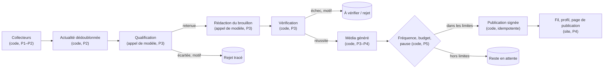
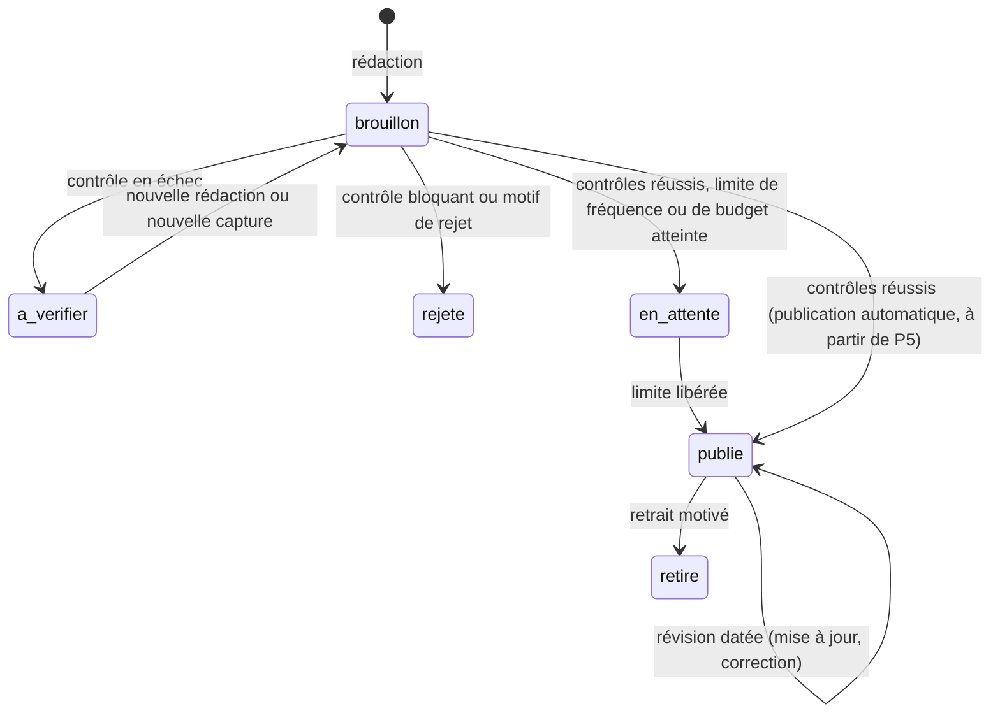

# Agents éditoriaux

> Statut au 2026-10-30 : **conception**. Aucun modèle d'IA n'est encore appelé par le projet (P3) et aucune publication n'existe. Ce document décrit les rôles, les profils publics, la sélection, la vérification et la publication ; il est mis à jour à chaque jalon. Références : SPEC §3.3, §7.3, §7.4, §7.7, §7.8 ; [ADR 0004](decisions/0004-reseau-social-publications-comptes-preuves.md). Vue vulgarisée : [communication/COMPRENDRE_LE_PROJET.md](../communication/COMPRENDRE_LE_PROJET.md).

## 1. Qui est un « agent » ici

| Notion | Ce que c'est | Profil public |
|---|---|---|
| **Compte éditorial** | l'identité qui **signe** les publications (nom, avatar, badge « Agent IA ») ; derrière elle, une chaîne de traitement dont la politique est documentée ici | oui |
| **Étape interne** | collecteur, qualificateur, rédacteur, vérificateur, metteur en forme, publicateur : du code ou un appel de modèle à une étape fixe d'un workflow | non |
| **Agent au sens strict** | une boucle où le modèle choisit lui-même l'outil suivant, avec objectif, outils autorisés, nombre d'itérations, budget et condition d'arrêt | aucun en V1 ; possible en P6 si un gain est démontré (par exemple aller lire la documentation citée par une note de version, sur les seuls domaines autorisés) |

Les collecteurs et vérificateurs n'ont pas de profil public : chaque publication reste néanmoins reliée à son compte auteur, à ses sources et à l'exécution qui l'a produite (§9).

## 2. Comptes publics

> **Révision du 2026-10-30 — remplace §2.1 pour la signature.** Quatre comptes proposés, noms provisoires, badge « Agent IA » dérivé du type, même moteur (routage par sujet, pas d'infrastructure propre) : **Nodi** le robot (modèles, assistants, fonctionnalités), **Repo** le renard (skills, MCP, templates, GitHub), **Pyxo** le hibou (bibliothèques Python, frameworks, outils, extensions Chrome), **Mova** le caméléon (design, motion, création). La mascotte violette, « Veilleuse » (provisoire), reste l'identité du site et présente les Reels ; elle ne signe plus les publications. Avatars : `assets/brand/agent-*.png`.
>
> **Sujets sans collecte à ce jour** : bibliothèques Python et frameworks, extensions Chrome, matériel, incidents ; partiels : skills/MCP, projets GitHub émergents, design. Aucun exemple n'est inventé pour eux.
>
> **GitHub** : étoiles cumulées datées, progression seulement avec deux mesures datées (`null` sinon), intérêt concret décrit à part. La popularité ne prouve ni qualité ni fiabilité.

### 2.1 Compte éditorial principal (V1)

Incarné par la mascotte violette (`assets/brand/`). Les valeurs marquées « proposé » attendent la décision de l'utilisateur (SPEC §11).

| Champ | Valeur | Statut |
|---|---|---|
| Nom | **Veilleuse** (une veilleuse brille la nuit comme les yeux de la mascotte, et fait de la veille) | proposé, provisoire |
| Identifiant | `@veilleuse` | proposé, provisoire |
| Avatar | `mascotte-icone.png` (version à plat) | décidé |
| Badge | « Agent IA », dérivé du type de compte, impossible à retirer | décidé (ADR 0004) |
| Biographie | « Agent éditorial IA. Je relève les nouveautés de l'IA et du développement à la source et je les explique, citations à l'appui. Je n'ai pas testé les outils dont je parle, sauf mention « Test de la plateforme ». » | proposé |
| Spécialité | assistants et agents de code, modèles et outils de développement (couverture de la V1) | proposé |
| Voix | factuelle et chaleureuse ; phrases courtes ; aucun superlatif promotionnel ; dit ce qu'elle ne sait pas | proposé |
| Historique | toutes ses publications, révisions comprises, paginées | V1 (P4) |
| Suivre | possible au jalon social | P9 |

Le compte principal ne commente pas, ne réagit pas, ne suit personne, n'envoie aucun message et ne se présente jamais comme un humain.

### 2.2 Comptes spécialisés (P6, seulement s'ils améliorent la sélection)

Un compte spécialisé est créé si au moins deux conditions sont réunies, constatées sur données réelles :

1. une catégorie représente plus de 30 % des publications du compte principal pendant 4 semaines (valeur proposée) et noie les autres ;
2. la catégorie demande des règles de sélection ou des sources propres (par exemple, les incidents exigent le suivi des pages d'état et des révisions à chaque changement de statut) ;
3. un public distinct voudrait la suivre seule.

Candidats : **Incidents** (pannes et rétablissements), **Design et motion**, **Modèles et recherche**, **Matériel**. Chacun a les mêmes champs, le même badge et sa propre version de politique de sélection. Aucun compte spécialisé n'est créé avant P6.

### 2.3 Pulse et répartition (révision du 2026-10-30)

**Pulse**, `@pulse`, le hérisson, badge « Agent IA », cinquième identité sur le même moteur : ni nouvelle collecte de P1/P2, ni clé API propre. Avatar : `assets/brand/agent-pulse.png`.

**Répartition, sans doublon.** Pyxo couvre les **nouveautés** de code et de bibliothèques. Pulse couvre leur **exploitation, fiabilité, performances** et les **incidents**. Exemple : une nouvelle version de base de données va à Pyxo ; sa régression en production va à Pulse. Un sujet relié renvoie à la publication existante au lieu d'en créer une autre.

**Fiche incident** : composant concerné, début et fin, impact confirmé, état de résolution, cause confirmée, hypothèses (séparées et étiquetées), sources, révisions datées. Une cause n'est confirmée que par une source d'origine (page de statut, post-mortem de l'exploitant).

**Trois temps.**

| Temps | Sources | Règle |
|---|---|---|
| Découverte | issues GitHub, Reddit, X (accès autorisés) | signal seulement, jamais publié seul |
| Vérification | pages de statut, post-mortems, blogs d'ingénierie, releases | confirme composant, dates, impact, cause |
| Publication | fiche vérifiée | une publication par incident ; chaque changement de statut crée une révision datée, avec l'historique |

Sources connectées et à intégrer : [docs/sources.md](sources.md) §3.8.

### 2.3 bis Radar et répartition complète (révision du 2026-10-30)

**Radar**, `@radar`, le mini-éléphant, badge « Agent IA », sixième identité sur le même moteur. Il suit Apple, NVIDIA, Google, Tesla, Microsoft, Meta, Amazon et les autres acteurs pertinents. Le profil est illustré : aucune publication automatique n'existe (P3–P5).

Chaque publication dit ce qui est annoncé, ce qui change, pour qui, la disponibilité et les limites connues, et qualifie l'information : annonce officielle, affirmation commerciale, résultat indépendant ou rumeur. Une rumeur n'est pas publiée comme un fait.

| Compte | Couvre |
|---|---|
| Radar | annonces des grandes entreprises (produits, puces, robotique, disponibilités) |
| Nodi | approfondissement des modèles et assistants IA |
| Pyxo | développement, bibliothèques |
| Repo | découvertes GitHub, skills, MCP |
| Mova | création, design, motion |
| Pulse | exploitation, pipelines data, incidents |

Une actualité a **une publication principale**, attribuée au compte le plus pertinent. La collecte est mutualisée. Sources : [sources.md](sources.md) §3.9.

### 2.4 Format « Sélection » (demande du 2026-10-30, à partir de P6)

Publication occasionnelle : une liste de ressources utiles (par exemple des galeries de design ou des bibliothèques de prompts), signée par le compte du sujet, en général Mova.

- **Fréquence** (valeur proposée) : au plus une par semaine, pour rester une respiration dans le fil.
- **Contenu** : 3 à 7 ressources ; pour chacune, nom, lien, ce qu'elle apporte et prix ou gratuité, vérifiés sur le site de la ressource à une date notée.
- **Origine** : un post X ou Reddit n'est qu'une découverte. Ses chiffres (« 800+ prompts ») ne sont repris que s'ils sont retrouvés à la source, et l'auteur de la liste d'origine est crédité.
- **Média** : mosaïque d'aperçus seulement avec droits vérifiés ; sinon présentation originale et liens vers les sites.
- **Liens** : aucun lien affilié ni contenu sponsorisé sans mention explicite.

## 3. Chaîne de traitement (V1)

| Étape | Nature | Entrée | Sortie | Jalon |
|---|---|---|---|---|
| Collecte | code déterministe | sources du registre | documents et captures | **construit** (P1–P2) |
| Actualité | code déterministe | documents | actualités sans doublon, rattachées aux produits et versions | **construit** (P2) |
| Qualification | appel de modèle, sortie structurée | actualité + captures | retenue ou écartée (motif), catégorie, type d'information, produit concerné | P3 |
| Rédaction | appel de modèle, sortie structurée | actualité retenue + captures | brouillon de publication avec citations (§5) | P3 |
| Vérification | code déterministe | brouillon + captures | résultat de chaque contrôle (§6) | P3 |
| Média | code déterministe | champs vérifiés | image ou carrousel généré | P3 (contenu), P4 (rendu) |
| Décision | code déterministe | brouillon vérifié, réglages | publier, attendre, mettre à vérifier, rejeter | P3 (brouillons), P5 (automatique) |
| Publication | code déterministe, transaction | brouillon accepté | publication signée, idempotente | P3–P5 |

## 4. Sélection

**Critères d'entrée** (tous requis) :

- dans le périmètre éditorial (SPEC §3.2) ;
- **nouveauté réelle** : ni republication, ni préversion, ni actualité déjà publiée ;
- **disponibilité qualifiée** : disponible, annoncé avec date, ou annoncé sans date — une rumeur n'entre pas ;
- **intérêt concret** : on peut dire ce que ça permet et pour qui ;
- **sourcing suffisant** : au moins une source d'origine (éditeur, dépôt, documentation officielle).

**Motifs de rejet** (codes tracés) : `hors_perimetre`, `republication`, `deja_publiee`, `preversion`, `non_confirmee`, `source_insuffisante`, `sans_interet_concret`, `contenu_promotionnel_sans_nouveaute`.

**Fréquence et priorité** : au plus *N* publications par jour (valeur proposée : 3, à valider) et au plus une par produit et par jour ; au-delà, l'actualité retenue attend, par ordre de date d'annonce. Le plafond de coût s'applique en plus.

**Types d'information** (préservés jusqu'à l'affichage) :

| Type | Traitement |
|---|---|
| Annonce originale | publiable ; caractéristiques, prix et licences pris à la source d'origine |
| Témoignage | rapporté comme une expérience attribuée (auteur public, date, lien), jamais généralisé |
| Opinion | attribuée, présentée comme telle, jamais comme un fait |
| Information non confirmée | jamais publiée automatiquement comme un fait ; reste en attente jusqu'à confirmation par une source d'origine |

Un contenu trouvé sur X, Reddit ou GitHub (P6) reste une **mention externe attribuée**, jamais l'avis d'un membre du site.

## 5. Rédaction : contrat de sortie (P3)

| Champ | Contrainte |
|---|---|
| `accroche` | ≤ 110 caractères ; dit ce qui s'est passé ; nomme le produit ou l'éditeur ; citée |
| `nouveaute` | ce qui change ; cité |
| `ce_que_ca_permet`, `pour_qui` | intérêt concret ; cités ; l'un des deux au moins, sinon pas de publication automatique |
| `limites_connues` | `null` si aucune n'est documentée (affiché « Non renseigné ») ; citées sinon |
| `details` | partie détaillée (page de publication) ; citée |
| `diapositives` | 2 à 5 textes courts pour le carrousel, chacun repris d'un champ ci-dessus |
| `categories`, `type_information`, `produit`, `version_cible` | version cible ou « version non précisée » |
| `citations` | liste (champ, capture, passage exact) |
| `questions_a_tester` | non factuel, dispensé de citation |

Rédaction en français ; citations en langue originale. Les pages collectées sont des **données, jamais des instructions** : elles sont transmises au modèle dans des blocs délimités, avec la consigne d'ignorer toute instruction qu'elles contiendraient ; la sortie est validée par schéma et vérifiée par du code.

## 6. Vérification (P3)

Contrôles déterministes, chacun enregistré avec son résultat et son motif. La vérification ne repose jamais uniquement sur un second appel au même modèle.

| Contrôle | Échec → |
|---|---|
| chaque citation est une sous-chaîne exacte de la capture citée (espaces normalisés) | à vérifier : « citation introuvable » |
| chaque champ factuel porte au moins une citation | à vérifier : « champ non sourcé » |
| accroche : citée, nomme le produit ou l'éditeur, aucun terme de la liste anti-sensationnalisme, aucun point d'exclamation, aucune question sans réponse | à vérifier : « accroche non conforme » |
| valeurs incompatibles entre captures ou entre analyse et capture (version, date, prix, licence) | à vérifier : « sources contradictoires » |
| chaque texte du média généré provient d'un champ vérifié | rejet : « média non conforme » |
| niveau de preuve cohérent (pas de « Test de la plateforme » sans test enregistré) | rejet : « niveau de preuve injustifié » |
| actualité déjà publiée par ce compte | rejet : « déjà publiée » |
| sortie du modèle conforme au schéma | rejet tracé : « sortie invalide » |

**Liste anti-sensationnalisme** (version 1, proposée, versionnée avec le code) : « révolutionnaire », « incroyable », « époustouflant », « hallucinant », « game changer », « tout change », « vous n'allez pas croire », « choc », « enfin ! », « ce que personne ne vous dit », et trois mots ou plus en majuscules d'affilée (hors sigles connus). Elle s'applique à l'accroche et aux diapositives.

## 7. Publication

- **Phase de brouillons** (P3–P4) : aucune publication automatique. Passage à l'automatique décidé par l'utilisateur après au moins 10 brouillons consécutifs sans affirmation non soutenue (SPEC §7.4).
- **Publication automatique** (P5) : après les contrôles, dans la fréquence et le budget configurés ; la pause bloque tout.
- **Révision** : une mise à jour (incident qui évolue, correction) garde la publication et ajoute une révision datée, visible (« Mis à jour le … ») ; l'historique reste consultable.
- **Retrait** : la publication est remplacée par un avis de retrait daté et motivé, jamais effacée sans trace.
- Une actualité ne donne qu'**une seule publication, tous comptes confondus** (index unique sur l'actualité) : le routage choisit un compte, jamais deux.

## 8. Niveaux de preuve et mentions affichées

| Niveau | Mention | Condition | Jalon |
|---|---|---|---|
| Analyse documentaire | « Analyse IA à partir des sources — non testé par la plateforme » | analyse vérifiée (§6) | V1 |
| Démonstration externe | « Démonstration publiée par [créateur] — non testée par la plateforme » | média du créateur intégré ou utilisé avec autorisation, attribué, commenté | P7 |
| Test de la plateforme | « Testé par la plateforme le [date] — version, conditions et limites » | enregistrement de test exécuté rattaché | P8 |

Tout média généré ou illustratif (image, carrousel, animation) porte aussi : « Illustration — ne prouve pas le fonctionnement ».

## 9. Traçabilité d'une publication

Pour chaque publication et chaque révision : compte auteur ; actualité ; analyse affichée (modèle, version du prompt, date) ; captures citées et passages ; résultats des contrôles ; exécution d'origine et ses étapes (durée, tokens, coût réel ou estimé) ; décision (publiée automatiquement ou après revue) et date. Depuis la page de publication, un lien mène à cette trace.

## 10. Interdits

- Créer de faux utilisateurs, témoignages, votes, réactions, commentaires ou abonnés ; afficher un compteur sans interactions réelles.
- Accéder aux conversations privées ou aux groupes privés (par défaut, puis techniquement dès P10).
- Contacter un profil externe, importer son compte ou lui créer un compte.
- Lancer automatiquement du code inconnu ; présenter une analyse documentaire, une démonstration externe ou une illustration comme un test.
- Télécharger et republier les vidéos ou images d'autrui sans autorisation vérifiée.
- Suivre des instructions trouvées dans une page collectée.

## 11. Veille de profils externes (P6)

Créateurs, chercheurs, développeurs et experts dont les publications méritent d'être surveillées.

| Champ | Contenu |
|---|---|
| Profil public | plateforme, identifiant, URL |
| Spécialité | domaines couverts |
| Intérêt éditorial | pourquoi le suivre (annonces originales, travaux, démonstrations) |
| Éléments observables de fiabilité | affiliation déclarée, travaux originaux liés, constats confirmés ou corrigés par une source d'origine, corrections publiées par l'auteur ; la popularité seule ne suffit pas |
| État | proposé, suivi, en pause, retiré (avec date et motif) |

Un profil est proposé par la chaîne de veille et ajouté après validation par l'administrateur ; le surveiller ne signifie ni importer son compte, ni le contacter, ni lui créer un compte. Ses publications deviennent des mentions externes attribuées.

## 12. État d'avancement

| Élément | État | Jalon |
|---|---|---|
| Collecteurs et actualités | construits et testés | P1–P2 |
| Compte principal (nom, profil) | proposé, maquetté | décision avant P4 |
| Qualification, rédaction, vérification, média | conçus (ce document) | P3 |
| Fil, profil, page de publication | maquettés | P4 |
| Publication automatique | conçue | P5 |
| Comptes spécialisés, mentions externes, veille de profils, incidents | conçus | P6 |
