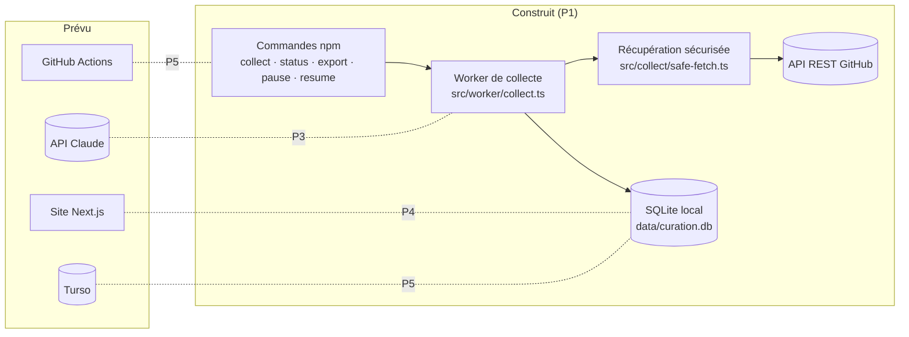
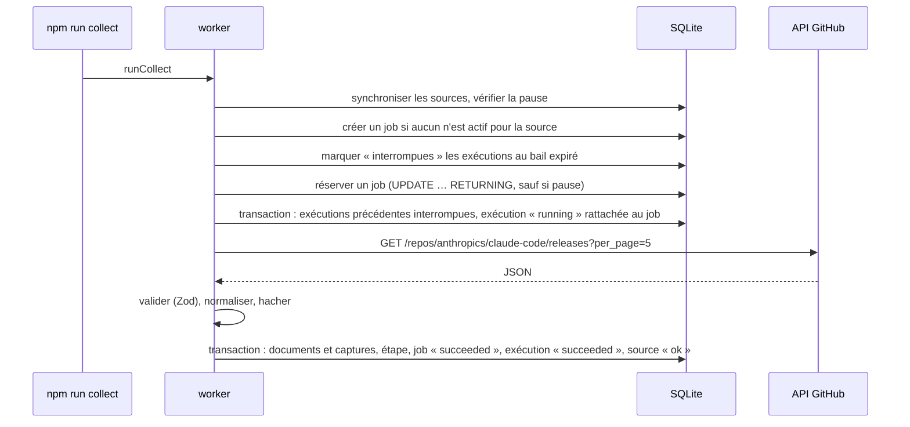

# Architecture

> État au 2026-10-30 (P1). Ce qui est **construit** est distingué de ce qui est **prévu**. Vue produit et vulgarisée : [communication/COMPRENDRE_LE_PROJET.md](../communication/COMPRENDRE_LE_PROJET.md).

## Vue d'ensemble

Un seul dépôt, un seul langage (TypeScript), deux points d'entrée à terme : le worker (commandes) et le site. Aucun modèle d'IA n'intervient en P1 : la collecte est du code déterministe.

## Modules (P1)

| Module | Responsabilité |
|---|---|
| `src/config.ts` | configuration lue depuis l'environnement ; URL de base affichée sans secret |
| `src/db/` | schéma Drizzle, ouverture de la base (`@libsql/client`), migrations, nouvelle tentative sur verrou SQLite |
| `src/collect/safe-fetch.ts` | HTTPS seulement, liste blanche d'hôtes, IP résolues vérifiées puis connexion épinglée à l'adresse validée, pas de redirection, délai et taille maximum |
| `src/collect/github-releases.ts` | URL de l'API, validation de la réponse (Zod), transformation en documents normalisés |
| `src/collect/normalize.ts` | URL canoniques, dates ISO UTC, texte normalisé, empreinte SHA-256 |
| `src/collect/store.ts` | enregistrement idempotent dans une transaction : nouveau, inchangé, ou nouvelle capture |
| `src/jobs/queue.ts` | file de jobs : création unique, réservation atomique, bail, reprises, échec définitif |
| `src/jobs/runs.ts` | traces d'exécution et d'étapes |
| `src/worker/collect.ts` | orchestration : sources → pause → jobs → récupération → validation → enregistrement → traces |
| `src/control/settings.ts` | interrupteur de pause |
| `src/export/export.ts` | export JSON lisible |
| `src/cli/` | commandes npm |

## Déroulé d'une collecte

## Cycle de vie d'un job

```mermaid
stateDiagram-v2
  [*] --> pending: création (un seul job actif par source)
  pending --> leased: réservation atomique, tentative +1
  leased --> succeeded: fin normale
  leased --> pending: échec, tentatives restantes (attente croissante)
  leased --> failed: échec, tentatives épuisées
  leased --> leased: bail expiré, repris par un autre worker (exécution précédente « interrompue »)
  leased --> failed: bail expiré, tentatives épuisées
```

## Données (P1)

| Table | Contenu | Unicité |
|---|---|---|
| `source` | sources configurées (code → base), liste blanche, état, dernier succès ou erreur | `id` |
| `source_document` | document collecté : URL d'origine et normalisée, version, date d'annonce (`null` si inconnue), première collecte, dernière vue | (source, identifiant externe) |
| `document_snapshot` | capture du contenu : empreinte, contenu normalisé, date, exécution | (document, numéro de capture) |
| `job` | travail à faire : statut, tentatives, bail, dernière erreur | un seul job actif par (type, source) — index unique partiel |
| `run` | exécution : mode réel ou fixture, statut, compteurs, erreur | `id` (UUID) |
| `run_step` | étapes d'une exécution (fetch, parse, store) avec durée et détail | (exécution, numéro d'étape) |
| `setting` | réglages de pilotage (pause) | `key` |

Dates : chaînes ISO 8601 en UTC, toujours au même format, donc comparables comme du texte. Le modèle cible complet (produits, versions, actualités, analyses, contributions) est décrit dans le brief et SPEC ; il sera construit à partir de P2.

## Garanties et limites connues (P1)

- **Idempotence** : une seconde collecte sans changement ne crée ni document ni capture ; un contenu modifié crée une seule nouvelle capture ; les champs descriptifs (date d'annonce, URL, prerelease) sont mis à jour sans nouvelle capture.
- **Atomicité** : trois transactions par exécution — début (exécutions précédentes du job interrompues, nouvelle exécution rattachée), fin réussie (documents, étape, job, exécution, source), échec (étape, job, exécution, source). Un arrêt brutal ne laisse jamais de trace incohérente ni d'écriture à moitié faite.
- **Concurrence** : deux collecteurs simultanés ne traitent jamais le même job (testé sur deux processus réels) ; base locale sans WAL, attente sur verrou et réouverture des connexions avant chaque nouvelle tentative ([ADR 0002](decisions/0002-sqlite-libsql-turso.md)).
- **Pause** : vérifiée dans l'instruction même de réservation ; une requête déjà partie va au bout et son résultat est enregistré.
- **Reprise** : un processus tué laisse un bail qui expire ; l'exécution est marquée « interrompue » et le job repris ; un worker dépossédé de son job ne modifie ni le job ni l'état de la source.
- **Sécurité de collecte** : HTTPS avec certificat vérifié, liste blanche d'hôtes, adresses IP résolues vérifiées (plages privées, locales, réservées et de transition IPv6 refusées) puis connexion épinglée, aucun proxy implicite, aucune redirection, délai couvrant DNS et requête, taille maximum ; secrets masqués dans les messages d'erreur.
- **Traçabilité du mode** : chaque capture est rattachée à son exécution, donc à son mode (réel ou fixture), visible dans l'export et le statut.
- **Limites** : le bail n'est pas prolongé pendant une collecte (5 minutes, largement au-dessus du délai réseau de 15 s) ; la politique de rétention des captures sera fixée avant P5 ; les contraintes de clé étrangère sont déclarées mais pas activées explicitement sur chaque connexion.
