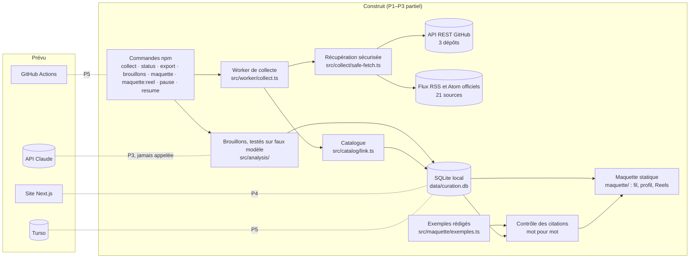
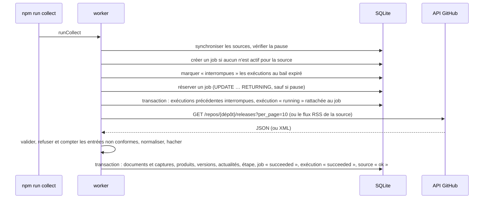
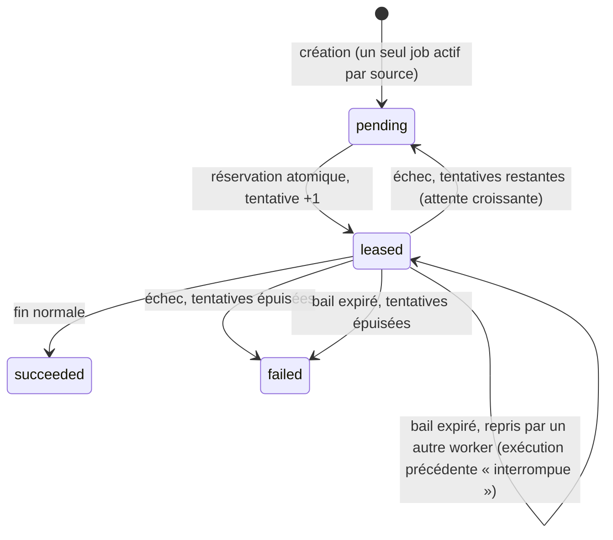
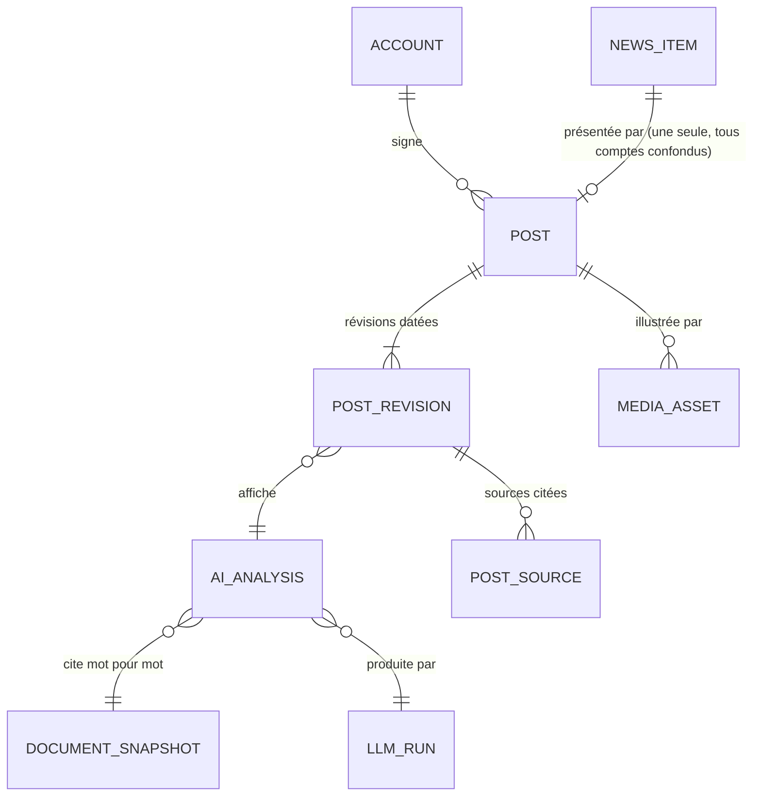

# Architecture

> État au 2026-10-31 (P3 en cours, non terminé). Ce qui est **construit** est distingué de ce qui est **prévu**. Vue produit et vulgarisée : [communication/COMPRENDRE_LE_PROJET.md](../communication/COMPRENDRE_LE_PROJET.md).

## Vue d'ensemble

Un seul dépôt, un seul langage (TypeScript), deux points d'entrée à terme : le worker (commandes) et le site. Aucun modèle d'IA n'intervient en P1–P2 : la collecte et le rattachement sont du code déterministe.

## Modules (P1–P2)

| Module | Responsabilité |
|---|---|
| `src/config.ts` | configuration lue depuis l'environnement ; URL de base affichée sans secret |
| `src/db/` | schéma Drizzle, ouverture de la base (`@libsql/client`), migrations, nouvelle tentative sur verrou SQLite |
| `src/collect/safe-fetch.ts` | HTTPS seulement, liste blanche d'hôtes, IP résolues vérifiées puis connexion épinglée à l'adresse validée, pas de redirection, délai et taille maximum |
| `src/sources.ts` | sources configurées : identifiant, hôtes autorisés, produit déclaré (releases), hôtes des liens (flux), limite de taille éventuelle |
| `src/collect/github-releases.ts` | URL de l'API, validation de la réponse (Zod), contrôle du dépôt, transformation en documents normalisés, numéro de version |
| `src/collect/feeds.ts` | lecture RSS/Atom (un seul décodage des entités), liens limités aux hôtes de la source, entrées refusées comptées, plafond de 3 000 entrées |
| `src/collect/normalize.ts` | URL canoniques, dates ISO UTC, texte normalisé, empreinte SHA-256 |
| `src/collect/store.ts` | enregistrement idempotent dans une transaction : nouveau, inchangé, ou nouvelle capture |
| `src/catalog/link.ts` | produits, versions et actualités, dans la même transaction ; rattrapage des documents non rattachés ([ADR 0003](decisions/0003-identite-produits-versions-actualites.md)) |
| `src/maquette/data.ts` | données de la maquette : actualités de collectes réelles, extraits en texte brut ; exemples rattachés à leur actualité et contrôle mot pour mot (mots entiers) de chaque passage cité dans la dernière capture du document, qui doit venir d'une collecte réelle, et des nombres écrits en chiffres (`verifierExemple`) |
| `src/analysis/` | P3 : qualification, rédaction, contrôles déterministes (`controles.ts`, `valeurs.ts`), budget réservé avant appel, lot exclusif, publication non publiée (`publication.ts`) ; tables `llm_run`, `llm_call`, `post_draft`, vides à ce jour. Testé avec un faux modèle, jamais exécuté avec le vrai modèle |
| `src/maquette/exemples.ts` | 8 exemples de publications rédigés par Claude Code pour la maquette (pas par l'agent du site), compte éditorial proposé, comptes envisagés |
| `src/maquette/reel.ts` | Reel d'exemple : segments repris des champs vérifiés, mise en page du texte, sous-titres WebVTT (fonctions pures) |
| `src/cli/maquette-reel.ts` | rendu du Reel (macOS : `say`, ffprobe, ffmpeg) vers `maquette/medias/` ; refuse un exemple « à vérifier » |
| `src/jobs/queue.ts` | file de jobs : création unique, réservation atomique, bail, reprises, échec définitif |
| `src/jobs/runs.ts` | traces d'exécution et d'étapes |
| `src/worker/collect.ts` | orchestration : sources → pause → jobs → récupération → validation → enregistrement → traces |
| `src/control/settings.ts` | interrupteur de pause |
| `src/export/export.ts` | export JSON lisible |
| `src/cli/` | commandes npm |

## Déroulé d'une collecte

## Cycle de vie d'un job

## Données (P1–P2)

| Table | Contenu | Unicité |
|---|---|---|
| `source` | sources configurées (code → base), liste blanche, état, dernier succès ou erreur | `id` |
| `source_document` | document collecté : URL d'origine et normalisée, version, date d'annonce (`null` si inconnue), première collecte, dernière vue | (source, identifiant externe) |
| `document_snapshot` | capture du contenu : empreinte, contenu normalisé, date, exécution | (document, numéro de capture) |
| `job` | travail à faire : statut, tentatives, bail, dernière erreur | un seul job actif par (type, source) — index unique partiel |
| `run` | exécution : mode réel ou fixture, statut, compteurs, erreur | `id` (UUID) |
| `run_step` | étapes d'une exécution (fetch, parse, store) avec durée et détail | (exécution, numéro d'étape) |
| `setting` | réglages de pilotage (pause) | `key` |
| `product` | produit suivi : clé canonique déclarée, nom, éditeur, catégorie, dépôt | `key` |
| `product_version` | version d'un produit : numéro, préversion, date, document d'origine | (produit, numéro) |
| `news_item` | actualité du fil : type (« version » ou « annonce »), titre, date d'annonce, première vue, statut | `id` |
| `news_item_document` | documents d'une actualité : source principale (`primary`) ou secondaire (`supporting`) | un document est la source principale d'au plus une actualité |
| `news_item_target` | produit et version concernés par une actualité | au plus une actualité par version |

Dates : chaînes ISO 8601 en UTC, toujours au même format, donc comparables comme du texte.

## Modèle de publication de la V1 (tables créées en P3, vides ; fil prévu en P4)

[ADR 0004](decisions/0004-reseau-social-publications-comptes-preuves.md) : l'actualité reste l'événement dédoublonné ; le fil montre des **publications** signées par un **compte**. Dans le schéma ci-dessous, `AI_ANALYSIS` correspond à la table `post_draft` ; les affirmations et leurs citations sont stockées dans son contenu JSON, pas dans une table à part.

| Table (créée en P3) | Contenu | Contraintes clés |
|---|---|---|
| `account` | compte public : identifiant, nom, avatar, biographie, spécialité, type `agent` ou `human` | badge « Agent IA » dérivé du type ; six agents aux noms provisoires, repris de la maquette |
| `post` | publication : compte, actualité, niveau de preuve (`documentary_analysis`, `external_demo`, `platform_test`), statut, dates | une seule publication par actualité, tous comptes confondus ; `platform_test` refusé par la base sans référence de test (le test exécuté lui-même arrive en P8) ; avant P5, rien n'atteint `publie` |
| `post_revision` | contenu affiché : accroche, nouveauté, ce que ça permet, pour qui, limites, détails, diapositives désignées par champ ; analyse d'origine (`post_draft`) | une mise à jour crée une révision, jamais une nouvelle publication |
| `post_source` | documents et captures cités par une révision | créée avec la révision |
| `media_asset` | média : origine (`generated`, `platform_recording`, `external_embed`, `licensed_reuse`), texte alternatif, textes des diapositives, licence et attribution | V1 : `generated`, avec exception `licensed_reuse` pour les photos de kits presse de Radar (complément de l'ADR 0004) ; mention « Illustration — ne prouve pas le fonctionnement » |

La maquette de P2 préfigure ce modèle sans l'implémenter : les exemples de `src/maquette/exemples.ts` ont la forme d'une révision de publication (champs cités, diapositives qui ne reprennent que des champs vérifiés), et le contrôle des citations de `verifierExemple` est celui que le vérificateur de P3 appliquera. Le reste du modèle cible (contributions, réactions, abonnements, messagerie) arrive à partir de P9 ; il est décrit dans SPEC et le brief.

## Garanties et limites connues (P1–P2)

- **Idempotence** : une seconde collecte sans changement ne crée ni document ni capture ; un contenu modifié crée une seule nouvelle capture ; les champs descriptifs (date d'annonce, URL, prerelease) sont mis à jour sans nouvelle capture.
- **Atomicité** : trois transactions par exécution — début (exécutions précédentes du job interrompues, nouvelle exécution rattachée), fin réussie (documents, étape, job, exécution, source), échec (étape, job, exécution, source). Un arrêt brutal ne laisse jamais de trace incohérente ni d'écriture à moitié faite.
- **Concurrence** : deux collecteurs simultanés ne traitent jamais le même job (testé sur deux processus réels) ; base locale sans WAL, attente sur verrou et réouverture des connexions avant chaque nouvelle tentative ([ADR 0002](decisions/0002-sqlite-libsql-turso.md)).
- **Pause** : vérifiée dans l'instruction même de réservation ; une requête déjà partie va au bout et son résultat est enregistré.
- **Reprise** : un processus tué laisse un bail qui expire ; l'exécution est marquée « interrompue » et le job repris ; un worker dépossédé de son job ne modifie ni le job ni l'état de la source.
- **Sécurité de collecte** : HTTPS avec certificat vérifié, liste blanche d'hôtes, adresses IP résolues vérifiées (plages privées, locales, réservées et de transition IPv6 refusées) puis connexion épinglée, aucun proxy implicite, aucune redirection, délai couvrant DNS et requête, taille maximum ; secrets masqués dans les messages d'erreur.
- **Traçabilité du mode** : chaque capture est rattachée à son exécution, donc à son mode (réel ou fixture), visible dans l'export et le statut ; le mode fixture exige une seule source ; la maquette écarte toute capture qui ne vient pas d'une collecte réelle.
- **Catalogue** : déterministe, sans doublon par construction (index uniques), rattrapage des documents non rattachés ; « trou possible » signalé quand toutes les entrées reçues sont nouvelles après une collecte réussie ([ADR 0003](decisions/0003-identite-produits-versions-actualites.md)).
- **Contenus collectés** : stockés tels que publiés (HTML ou Markdown), donc non fiables ; à afficher en texte brut ou assainis côté serveur (critère de P4).
- **Limites** : le bail n'est pas prolongé pendant une collecte (5 minutes, largement au-dessus du délai réseau de 15 s) ; la politique de rétention des captures sera fixée avant P5 ; les contraintes de clé étrangère sont déclarées mais pas activées explicitement sur chaque connexion.
